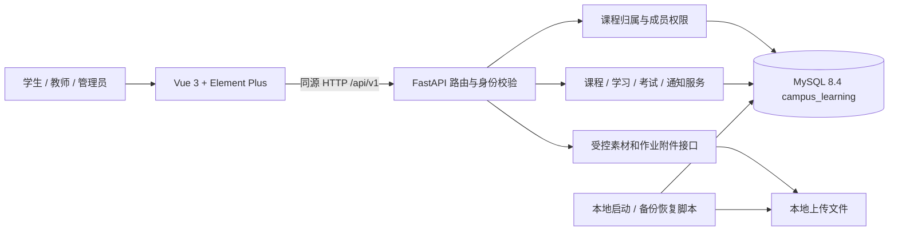
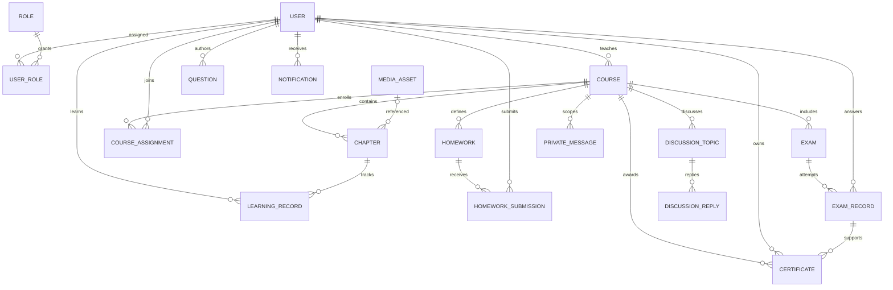
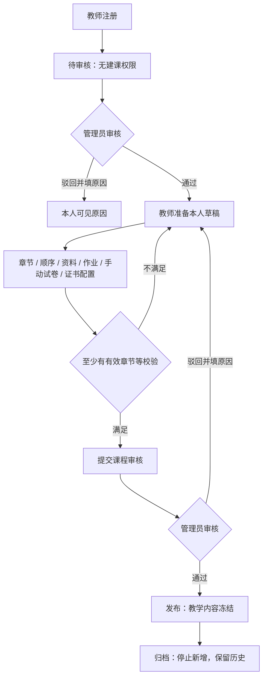
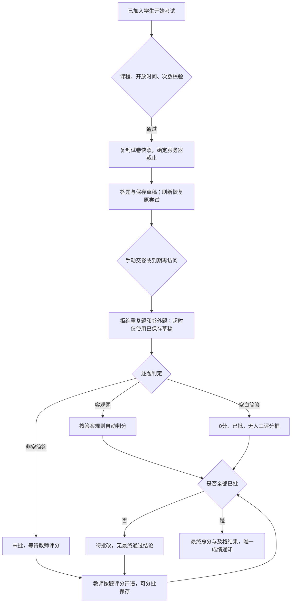
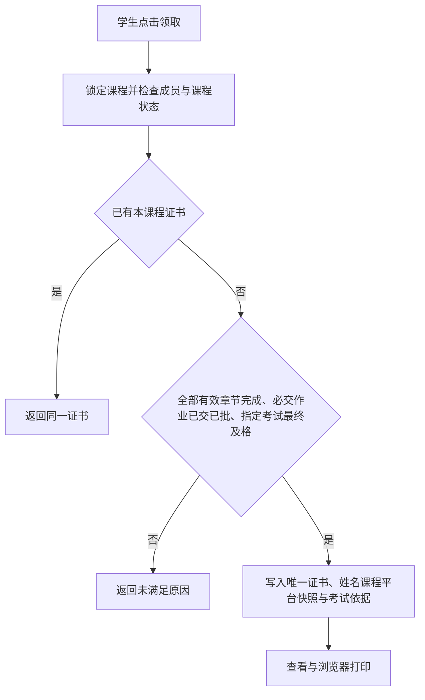

# 校园在线学习平台设计说明

日期：2026-10-30。对应[精简需求 V1.4](CAMPUS-LEARNING-REQUIREMENTS.md)，按当前代码组织编写，包含空白简答题自动零分和章节排序。适用于实验周本地演示规模。

## 1. 总体结构

系统是同源部署的单体应用。Uvicorn 运行 FastAPI，提供接口与静态网页；浏览器通过 Vue 3、Element Plus 及普通 JavaScript 完成界面交互。SQLAlchemy 同步会话通过 PyMySQL 访问项目独立 MySQL 8.4。上传文件放在本地存储目录，文件内容由受控接口读取，不公开映射整个上传目录。

运行入口为 `scripts/start-local.ps1`；其先执行 `setup_local.py` 确认本项目数据库、普通应用账号与迁移，再后台启动应用。默认网站为 `127.0.0.1:20081`，数据库为 `127.0.0.1:3309`。配置来自本地 `backend/.env`；账号、密钥、运行日志与数据库不随源码提交。

## 2. 模块与代码

| 模块 | 后端入口 | 页面及职责 |
|---|---|---|
| 账号与审核 | `auth.py`、`users.py`、`api/deps.py`、`session_service.py` | `app.js`：注册登录、本人资料、教师审核与用户管理 |
| 课程与资料 | `courses.py`、`media.py`、`campus_access.py`、`media_access.py` | `app.js`：课程中心、草稿章节编辑、顺序、素材选择、学习和预览 |
| 学习进度 | `learning.py`、`learning_service.py` | 课程页与学生表：章节完成、进度、视频位置、作业及最终考试成绩 |
| 作业 | `homework.py`、`schemas/homework.py` | `homework.js`：共用作业详情、文字/单附件提交与评分 |
| 题库和考试 | `exams.py`、`schemas/exam.py`、`campus_exam_service.py` | `app.js` 题库/答题；`exams.js` 组卷、记录与人工阅卷 |
| 讨论与私信 | `communication.py`、`models/communication.py` | `communication.js`：课程主题、一级回复、师生文字私信 |
| 通知 | `notifications.py`、`notification_service.py` | `app.js` 消息中心：列表、未读、已读与业务跳转 |
| 证书 | `certificates.py`、`models/certificate.py` | `certificates.js`：资格、唯一领取、教师颁发列表与打印 |
| 基础维护 | `platform.py`、`backup_restore.py` | `settings.js`：名称/注册开关；备份恢复由脚本执行 |

路由目录为 `backend/app/api/v1/`，服务目录为 `backend/app/services/`，前端目录为 `backend/static/js/`。数据库实体在 `backend/app/models/`，版本变更由 `backend/alembic/versions/` 管理。

## 3. 数据模型与 ER 图

下图是校园核心业务的逻辑关系，不是全部物理表的导出图。原项目保留的组织、字典、培训计划等辅助实体不纳入校园核心图。部分 `created_by`、`target_id`、`exam_id`、`content_ref_id` 在数据库中是普通 ID 字段，其归属和有效性由服务校验，图中的逻辑关联不表示一定具有数据库外键。

| 数据 | 关键保存内容 | 一致性约束 |
|---|---|---|
| 用户与会话 | 密码摘要、启停、教师审核字段、会话状态与令牌摘要 | 用户名/邮箱唯一；退出、改密、停用撤销会话 |
| 课程与章节 | 教师、状态、审核人/时间/原因、资料 ID、顺序 | 只改本人草稿；顺序为 0～1000000，按数字从小到大展示；需要明确先后时填写不同数字 |
| 成员与学习 | `CourseAssignment` 的用户目标、章进度/时长/位置 | 课程/分配类型/目标唯一；学生/课程/章节唯一 |
| 作业提交 | 当前文字、附件路径、分数、评语及批改时间 | 学生/作业唯一；未批是空值，0 分仍为已批 |
| 试卷与答卷 | 试卷快照、答卷快照、草稿、服务器截止、逐题结果 | 考试/学生/尝试号唯一；满分来自快照；最终成绩不重评 |
| 讨论与私信 | 纯文本、作者、课程、删除或已读时间 | 回复一级；正文范围由服务检查；管理员不能读取私信正文 |
| 通知与证书 | 事件标识、跳转 ID、颁发时显示快照和考试依据 | 通知事件唯一；学生/课程证书唯一，编号唯一 |

## 4. 身份与资源访问

登录后 JWT 携带会话标识，服务端同时校验会话、用户启停和角色；仅持有签名有效的旧令牌不保证仍可访问。角色用于判断业务能力，对课程、题库、作业和答卷还会检查归属或成员关系。

学生未加入时只能读取发布课程的简介与大纲；加入后才有正文、资料和考核权限。教师只管理本人课程和本人题库；管理员执行审核和管理操作。素材短期链接绑定当前会话与素材 ID，供视频/PDF 等原生资源读取；作业附件另外检查提交人或课程管理者身份。

## 5. 关键流程

### 5.1 审核与课程冻结

管理员退回草稿前检查成员、学习、提交、成绩、证书等依赖；已有活动的课程使用归档保留历史。章节顺序与正文一样受草稿状态及归属检查控制，不存在绕过冻结的单独排序接口。

### 5.2 交卷、空白零分与阅卷

截止时间取开始时间加时长与关闭时间的较早者。整卷满分始终取快照分值之和，漏答不减少满分。简答空白包括漏答、空值、空串、仅空白字符及接口兼容的空列表；这些答案不可人工改分。其余简答全部批完才发布最终结果。重复交卷返回已有结果；历史已提交成绩不因本次新规则批量重算。

### 5.3 证书领取

章节学习完成、考核及格、证书资格分别计算。领取通过后使用颁发时的姓名、课程与平台名称；不从后来改动的资料重新拼接历史证书。

## 6. 文件、事务与维护

素材及作业附件检查扩展名、大小和文件头，使用生成的路径保存。正文、讨论、私信和作业文字按纯文本展示。部分涉及状态切换、成员加入、进度、交卷与证书的操作使用课程行锁协调；唯一约束提供重复业务结果的最后保护。修改 JSON 答案时重新赋值，提交后使用新会话重读验证持久化。

备份在停止应用写入后运行，打包业务库 SQL、上传目录及版本/时间/文件摘要清单。恢复只允许新建 `campus_restore_*` 独立库和独立目录，核对表行数、数据抽样和文件摘要，不覆盖当前运行库。操作见 [README](../README.md)。

## 7. 演示与验证范围

正式演示准备入口为 [演示说明](DEMO.md) 与 `scripts/setup_demo.py`。脚本在项目独立数据库创建专用虚构数据；重复运行保留现有演示进度，发现账号冲突时拒绝覆盖。初始化直接写入完整演示配置，不用来证明注册、审核等页面流程通过。

功能核查见 [逐条需求报告](reports/REQUIREMENTS-REVIEW-2026-10-30.md)，本轮补齐证据见 [完成记录](reports/COMPLETION-2026-10-30.md)。真实接口/数据库、组件替身检查及浏览器操作分别记录；局部改动的检查不能替代所有场景的重新验收。
